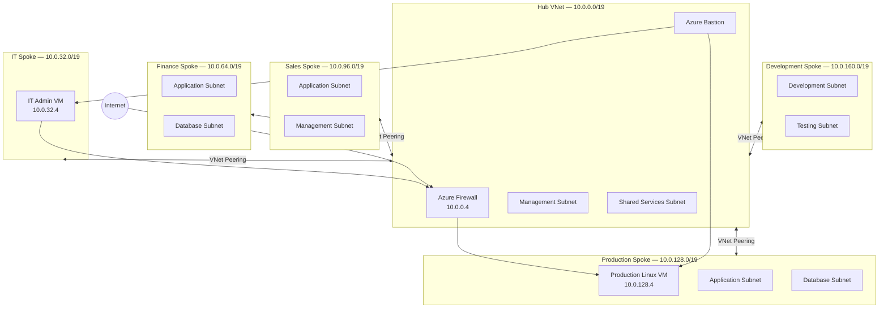

# Azure Enterprise Network Architecture

This diagram represents the original Hub-and-Spoke network design implemented for this project.

## Network Design Notes

- The Hub provides centralized network security and shared services.
- Five departmental Spoke VNets connect to the Hub through VNet peering.
- Direct Spoke-to-Spoke peering is not part of the design.
- Azure Firewall provides centralized traffic inspection.
- User Defined Routes direct workload traffic through the firewall.
- Azure Bastion provides administrative access to private virtual machines.
